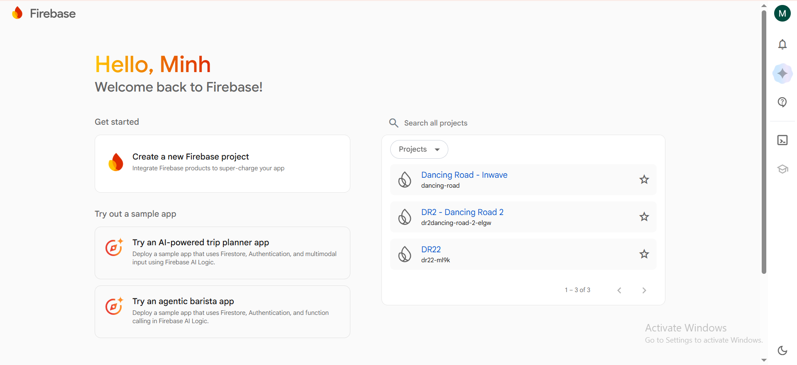
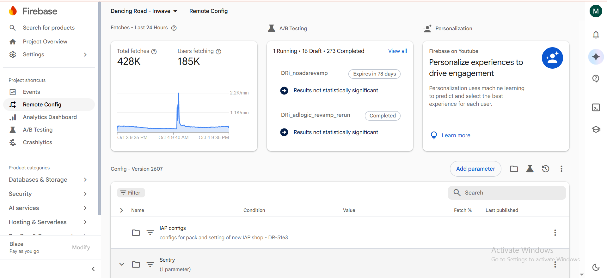
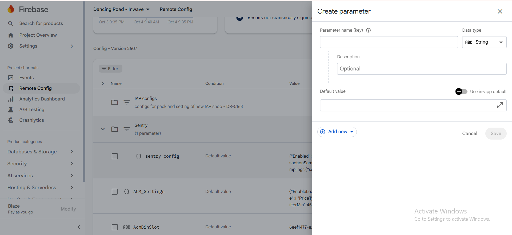
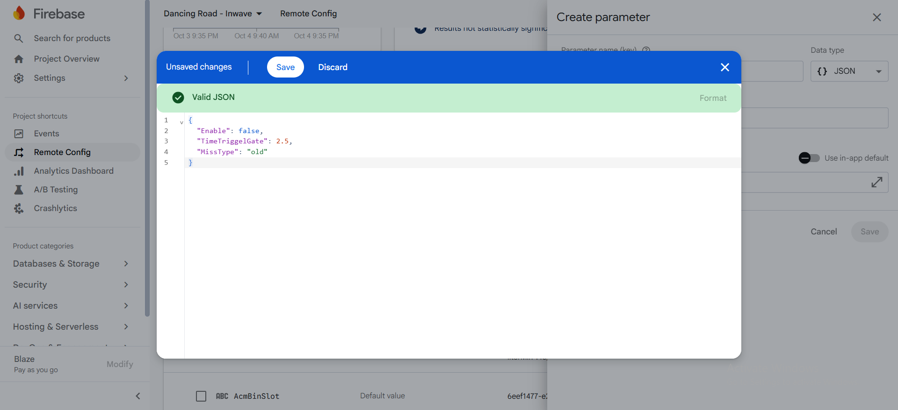
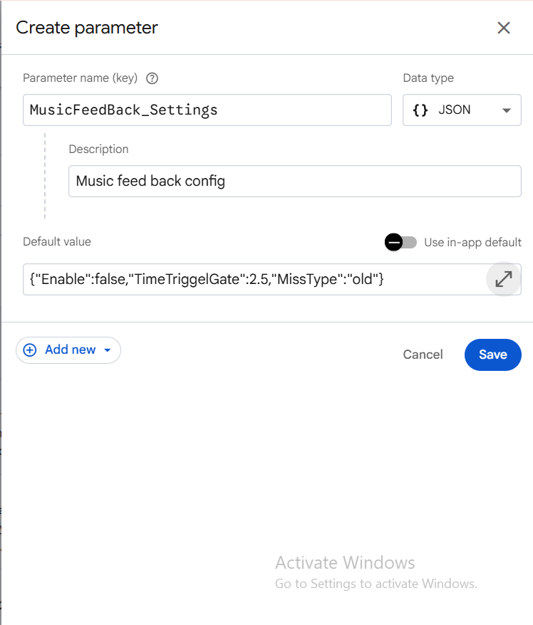
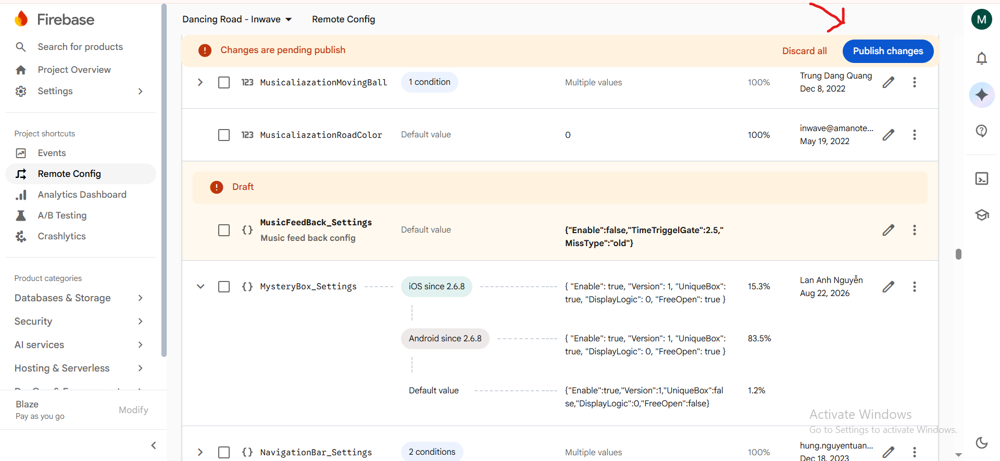
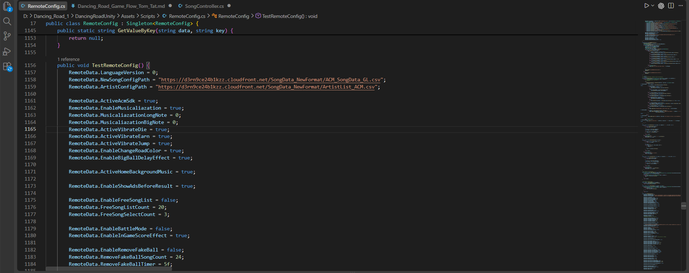
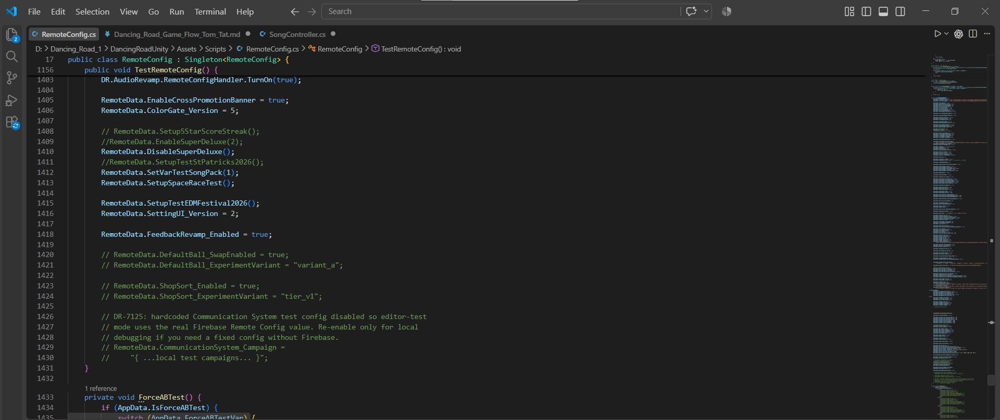

# Remote config DR

## 1. Remote config ở đây là gì, đúng hơn Firebase remote config ở đây là gì, tại sao chúng ta cần dùng nó?

- Bạn có thể hình dung Firebase Remote Config như một bảng điều khiển từ xa cho game. Thay vì mỗi lần muốn đổi cách hoạt động của một feature nào đó, ta phải sửa code, build và cập nhật lại app, team có thể tạo ra các biến config trong code rồi set up các biến config đó trên firebase remote config và dùng nó làm điều kiện để thay đổi hình thái chức năng. Khi người chơi mở game, app lấy những giá trị (parameter) từ trên firebase remote config tương ứng với các biến config bạn đã set up trong code để quyết định xem con game chúng ta sẽ hoạt động ra sao.

## 2. Bức tranh tổng quát hệ thống remote config của DR

- Khi app khởi động → FirebaseSDK.cs:Là nơi khởi động luồng firebase, nó lấy các remote config đã dược set up trên firebase xuống → RemoteConfig.cs : Là nơi sẽ xử lý 3 tình huống

- **Lấy được config trên firebase:** đọc các parameter, chuyển chúng thành đúng kiểu dữ liệu, gán vào RemoteData.cs, kiểm tra các điều kiện ghi đè config nếu có rồi gán lại vào RemoteData.cs

- **Chưa lấy kịp:** nếu máy có bản config lưu từ lần trước (lưu vô PlayerPrefs), game có thể dùng cache đó để đưa vào RemoteData.cs. Còn nếu không có cache, RemoteConfig sẽ chờ để fetch config trên firebase xuống, nếu chờ lâu quá sẽ dừng việc load remote config trên firebase luôn

- **Không lấy được hoặc chờ quá lâu:** game vẫn tiếp tục với giá trị mặc định trong RemoteData.cs

> → RemoteData.cs : Nơi khai báo các biến tĩnh config tương ứng với các parameter được set up trên Firebase Remote Config và nhận các giá trị config default hoặc từ RemoteConfig. Là nơi trung gian chính để các tính năng đọc các bộ config đã được set up và xử lý tương ứng.

## 3. Các bước để set up 1 remote config hoàn chỉnh

### Set up trong code

#### Bước 1: Khai báo field trong `RemoteData`

- tạo một file c# RemoteData riêng cho feature bạn làm: RemoteData.MyFeature.cs

- File này vẫn thuộc cùng một RemoteData nhờ từ khóa partial (nếu chưa biết class partial là gì có thể đọc tài liệu oop team cung cấp trước)

#### Bước 2: Tạo biến dữ liệu tương ứng với feature bạn đang làm

- Công thức tổng quát khi khai báo một biến:

```csharp
public static <kiểu dữ liệu> <tên field> = <giá trị mặc định>;
```

- Nguyên tắt của việc đặt tên biến:

- Công thức chung: MyFeature_Settings

- MyFeature: Tên của feature bạn đang làm

- Settings: ý nghĩa/mục đích của của biến được tạo

- Tất cả các biến khi đặt tên thì chữ cái đầu của mỗi từ đều phải viết hoa: ví dụ “MusicFeedBack_ChangeColor”

- Tất cả các biến được tạo đều phải đi kèm giá trị mặc định hợp lý, để trong trường Firebase lỗi hoặc fetch quá lâu, không lấy được giá trị về thì hệ thống vẫn sẽ dùng giá trị mặc định đã được khai báo để tiếp tục chạy.

- Lý do ta phải đặt MyFeature_Settings vì về sau khi ta set up remote config trên firebase thì Parameter name của ta sẽ đặt dạng MyFeature_Settings với Data type là dạng JSON. Khi fetch dữ liệu từ trên firebase về RemoteConfig.cs sẽ “ **MergeAllKeysCore()”** duyệt toàn bộ parameter Firebase, Khi gặp key chứa Settings, nó lấy chuỗi JSON sau đó parse chuỗi thành dictionary rồi bỏ chữ Settings khỏi tên parameter và gọi “**MergeNestedKeys()**”**.** “**MergeNestedKeys()**” duyệt từng key trong JSON, ghép tiền tố với tên key rồi tìm field tương ứng trong RemoteData. “**MergeNestedKeys()**” cũng chịu trách nhiệm chuyển dữ liệu sang kiểu của field như bool, int, float, string, int\[\] hoặc long

#### Bước 3: Đọc config trong feature

- Tại những nơi xử lý feature của bạn cần dùng đến config đã tạo tương ứng thì chỉ cần đơn giản gọi : RemoteData.MyFeature_Settings. Ví dụ :

```csharp
public static bool MusicFeedBackEnabled()
{
    return RemoteData.MusicFeedBack_Enable;
}
```

### Set up trên Firebase

#### Bước 1: Chọn project Firebase

Truy cập Firebase bằng email do công ty cấp, sau đó lựa chọn project bạn đang tham gia.



#### Bước 2: Mở Remote Config

Ở thanh Side navigation bên trái, lựa chọn mục Remote Config. Ở cái bảng Config bên dưới chính là nơi các config của dự án đã được tạo gồm các đầu mục Name(Tên/key của parameter) ,Condition(Điều kiện để Firebase áp dụng giá trị ở cột Value. Ví dụ: theo app, phiên bản, quốc gia, Installation ID, nhóm người dùng… Default value nghĩa là giá trị mặc định, được dùng khi không có condition nào phù hợp),Value(Giá trị mà Firebase trả về cho parameter khi condition tương ứng được thỏa mãn),Fetch(Tỷ lệ các request fetch Remote Config trong 24 giờ gần nhất đã nhận giá trị này. Ví dụ 100% nghĩa là trong 24 giờ qua, toàn bộ request fetch parameter đó đều được trả về giá trị ở dòng này),Last Published(Người đã publish lần thay đổi gần nhất và thời điểm publish)



#### Bước 3: Tạo parameter

Lựa chọn nút Add parameter, bạn sẽ thấy mục các thông tin để tạo một parameter.



- Trong đó sẽ có các hạng mục thông tin sau:

- Parameter name (key): Chính là tên biến remote config chính của feature bạn đang làm, nó được đặt theo công thức tương tự như cách bạn setup trong code: MyFeature_Settings. Ví dụ: MusicFeedBack_Settings

- Data type: Là định dạng biến remote config của bạn, ở đây chúng ta sẽ sử dụng định dạng JSON để có thể fetch về cùng lúc nhiều biến config thay vì phải tạo từng biến một theo định dạng riêng

- Description: Là chỗ để bạn viết mô tả về biến remote config của một cách tổng quát

- Default Value: Là chỗ bạn điền giá trị default biến remote config của bạn, với định dạng JSON ta sẽ điều như sau: Ví dụ bạn có 3 biến config (bool)MusicFeedBack_Enable, (float)MusicFeedBack_TimeTriggelGate, (string)MusicFeedBack_MissType



Đây sẽ là các thành phần Settings theo công thức chung MyFeature_Settings

```json
{
  "<ý nghĩa/mục đích biến được tạo>": "<giá trị của biến sẽ được fetch về>"
}
```

Sau đó bạn bấm save sẽ ra được đầy đủ như này



- Bấm save lại config vừa tạo xong rồi public change config mình vừa bổ sung vào dự án



- Trong trường hợp bạn muốn test remote config của bạn đã tạo có thực sự được fetch về và hoạt động chưa, bạn có thể vô hàm TestRemoteConfig() trong RemoteConfig.cs và set up config của bạn ở cuối hàm và quan sát playmode





## 4. Các lưu ý quan trọng khi thiết kế remote config trong code

- Khi xử lý thiết kế config trong remote data, phải lưu ý tới các config chứa các giá trị config về Ads, IAP, Subscription, No Ads và economy (Subscription_GroupName, IAPShop_SpecialOffers, IAPShop_SpecialOffers, IAPShop_GemOffers…).

- Tiếp theo là khi thiết kế cơ chế feature sử dụng tới các config được tạo, cũng cần phải lưu ý tới các luồng xử lý liên quan tới Ads, IAP, Subscription, No Ads và economy (AdsManager, IAPService, RevenueCatPurchases, SubscriptionController, NoAdsConfig …).

- Đó là các config, những nơi liên quan trực tiếp đến nguồn tiền của dự án, nghiêm cấm thay đổi hay xóa hoặc chèn logic vào.

- Nếu sử dụng AI để làm, phải bảo AI thật kỹ nghiêm cấm động vào các config liên quan tới Ads, IAP, Subscription, No Ads và economy, nếu cần thay đổi phải hỏi ý kiến của trước khi thay đổi.

## 5. Tổng kết

- Luồng tổng quát :

Mở game

↓

FirebaseSDK khởi tạo Firebase

↓

RemoteConfig đọc cache và bắt đầu fetch Firebase

↓

Chuyển dữ liệu về đúng kiểu

↓

Gán vào RemoteData

↓

EndLoad áp dụng các quy tắc cuối

↓

Báo config đã sẵn sàng

↓

Game tiếp tục khởi động

- Firebase remote config luôn là hệ thống rất tiện ích cho việc thay đổi các hành vi và nội dung trong game một cách linh động. Tuy nhiên, sự linh hoạt này cũng đi kèm nhiều rủi ro nếu Remote Config không được thiết kế và sử dụng đúng cách. Một giá trị sai, một condition không chính xác hoặc một cấu trúc JSON không tương thích có thể khiến tính năng hoạt động sai hoàn toàn. Vì vậy khi thiết kế remote config cần bám sát các nguyên tắt thiết kế remote config của dự án, xác đinh được những nơi nghiêm trọng có thể gây ảnh hưởng trực tiếp tới nguồn tiền dự án để tránh và hạn chế tối đa đụng vào, nếu có cần thay đổi thì phải xác nhận lại kỹ với các bên liên quan(dev,GD,PO,…) rồi mới thay đổi.
